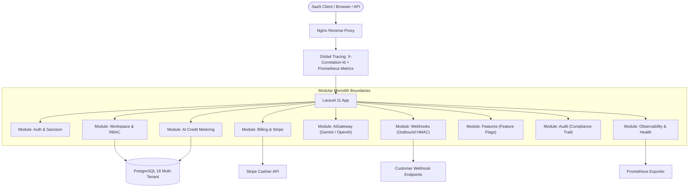

# SaaS MVP Modular Boilerplate

[](https://github.com/tech-akm/saas-mvp-modular-boilerplate/releases)
[](.github/workflows/ci.yml)
[](https://php.net)
[](https://laravel.com)
[](docker-compose.yml)
[](.github/workflows/lint.yml)
[](/docs)
[](LICENSE)
[](https://tech-akm.com)

A production-grade **Modular Monolith boilerplate for Laravel 11**, designed by [Tech AKM LLC](https://tech-akm.com) to launch scalable B2B/B2C SaaS MVPs in under 4 weeks without architectural debt.

---

## ⚡ Core Capabilities

- 🏢 **Multi-Tenant Workspaces**: Out-of-the-box tenant isolation via `TenantScope` Eloquent query guards, signed invitation links, and RBAC (Owner, Admin, Member, Viewer).
- 💳 **Stripe Billing & Subscriptions**: Preconfigured plans (`starter`, `pro`, `enterprise`), cryptographic webhook signature verification (`Stripe\Webhook::constructEvent`), and subscription tier gates.
- ⚡ **AI Credit Metering & Gateway**: Atomic credit deductions, quota reset cycles, token reconciliation, and multi-provider LLM routing (OpenAI, Google Gemini).
- 🔔 **Outbound Customer Webhooks**: Customer-configurable webhook dispatching with HMAC-SHA256 signatures (`X-SaaS-Signature-256`) and delivery logs.
- 🚩 **Tenant Feature Flags**: Plan-based entitlements and per-workspace beta flag overrides with `@feature(...)` Blade directive.
- 📜 **Enterprise Compliance Audit Trail**: Immutable logging of tenant mutations (plan changes, role elevations, member removals) for SOC2/GDPR readiness.
- 🏥 **End-to-End Observability**: Deep readiness probes (`/health/ready`), liveness probes (`/health/live`), Prometheus metrics (`/metrics`), and distributed tracing (`X-Correlation-Id`).
- 📚 **Interactive OpenAPI Docs**: Self-hosted interactive Scalar API documentation at `/docs`.
- 🐳 **Docker-Ready**: Nginx, PHP 8.4-FPM, PostgreSQL 16, and Redis 7 configured in one `docker compose up`.

---

## 🏗️ System Architecture



---

## 📂 Project Structure

```
saas-mvp-modular-boilerplate/
├── app/
│   ├── Modules/
│   │   ├── Auth/             # Sanctum authentication, tokens, login & onboarding
│   │   ├── Workspace/        # Multi-tenant isolation, TenantScope, signed team invitations
│   │   ├── Billing/          # Stripe webhooks, tier gates (starter/pro/enterprise), Cashier
│   │   ├── Metering/         # Atomic AI credit deductions & transactional audit logs
│   │   ├── AiGateway/        # Multi-LLM provider gateway (OpenAI, Gemini) & token billing
│   │   ├── Webhooks/         # Outbound customer webhooks with HMAC-SHA256 signatures
│   │   ├── Features/         # Workspace feature flags & subscription entitlements
│   │   ├── Audit/            # Immutable compliance activity logs (SOC2/GDPR ready)
│   │   └── Monitoring/       # /health probes, Prometheus /metrics, X-Correlation-Id tracing
│   └── Providers/
│       ├── AppServiceProvider.php
│       └── ModuleServiceProvider.php # Auto-discovers and boots modules
├── bootstrap/
│   ├── app.php               # Middleware, routing, and exception telemetry
│   └── providers.php
├── config/
│   ├── app.php, database.php, logging.php
│   ├── modules.php, billing.php, monitoring.php, sanctum.php
├── docker/
│   ├── Dockerfile            # PHP 8.4-FPM with pdo_pgsql, redis, bcmath, pcntl, opcache
│   └── nginx/default.conf    # FastCGI proxy configuration
├── resources/
│   ├── docs/openapi.yaml     # OpenAPI 3.1 specification
│   └── views/
│       ├── dashboard.blade.php
│       └── docs.blade.php    # Scalar API reference
├── docker-compose.yml
└── public/
    └── index.php
```

---

## 🚀 Quick Start

### 1. Launch with Docker

```bash
git clone https://github.com/tech-akm/saas-mvp-modular-boilerplate.git
cd saas-mvp-modular-boilerplate
cp .env.example .env

docker compose up -d
docker compose exec app composer install
docker compose exec app php artisan key:generate
docker compose exec app php artisan migrate
```

- **Dashboard**: `http://localhost:8000`
- **Interactive API Docs**: `http://localhost:8000/docs`
- **Health Check**: `http://localhost:8000/health`
- **Prometheus Metrics**: `http://localhost:8000/metrics`

---

## 🧪 Automated Test Suite

Run the complete test suite (Unit & Feature tests covering all modules):

```bash
./vendor/bin/phpunit
```

---

## 💡 Key Code Examples

### 1. Multi-LLM Generation with Automated Metering
```php
use App\Modules\AiGateway\Services\AiGatewayService;

$gateway = app(AiGatewayService::class);

$result = $gateway->generate(
    prompt: "Write a high-converting landing page headline for a SaaS",
    model: "gemini-1.5-pro"
);

echo $result['content'];
echo "Credits Deducted: " . $result['credits_deducted'];
```

### 2. Feature Gating Routes & Blade Views
```php
// Route middleware
Route::middleware(['auth:sanctum', 'workspace', 'feature:api_access'])->group(function () {
    Route::get('/developer/keys', [ApiKeyController::class, 'index']);
});
```
```blade
{{-- Blade view directive --}}
@feature('custom_domain')
    <a href="/settings/domains">Configure Custom Domain</a>
@endfeature
```

### 3. Dispatching Outbound Customer Webhooks
```php
use App\Modules\Webhooks\Services\WebhookDispatcherService;

app(WebhookDispatcherService::class)->dispatch(
    workspaceId: $currentWorkspace->id,
    eventType: 'member.invited',
    payload: ['email' => 'alex@example.com', 'role' => 'admin']
);
```

---

## 🤝 Community & Support

- 💬 **GitHub Discussions**: Join our [Discussions Forum](https://github.com/tech-akm/saas-mvp-modular-boilerplate/discussions) for architecture Q&A.
- 🐛 **Issue Reporting**: Use our structured [Issue Forms](.github/ISSUE_TEMPLATE/) for bug reports and feature requests.
- 💖 **Sponsor Us**: Support open-source maintenance via [GitHub Sponsors](https://github.com/sponsors/tech-akm).

---

## 🛠️ Need Custom SaaS Engineering?

Need to ship your custom AI SaaS MVP in 4 weeks?

Reach out to **[Tech AKM LLC](https://tech-akm.com)** — we build high-concurrency Laravel, React, and Generative AI platforms:
- 🌐 Website: [https://tech-akm.com](https://tech-akm.com)
- 📧 Inquiries: [contact@tech-akm.com](mailto:contact@tech-akm.com)
- 🚀 Services: [https://tech-akm.com/services](https://tech-akm.com)

---

## 📄 License
MIT License &copy; 2026 [Tech AKM LLC](https://tech-akm.com). Free for commercial and personal SaaS projects.
