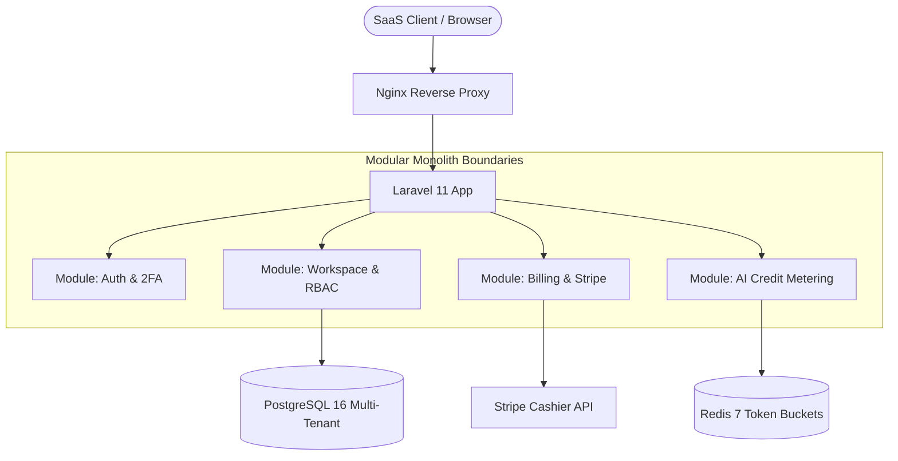

# SaaS MVP Modular Boilerplate

[](LICENSE)
[](https://php.net)
[](https://laravel.com)
[](docker-compose.yml)
[](https://tech-akm.com)

A production-ready **Modular Monolith boilerplate for Laravel 11**, designed by [Tech AKM LLC](https://tech-akm.com) to launch scalable B2B/B2C SaaS MVPs in under 4 weeks without architectural debt.

---

## ⚡ Why This Boilerplate?

Most SaaS boilerplates are either bloated spaghetti code or too minimal to be useful. **SaaS MVP Modular Boilerplate** enforces clean boundaries using a **Modular Monolith architecture**:

- 🏢 **Multi-Tenant Workspaces**: Out-of-the-box tenant isolation, workspace switcher, and role-based access control (Owner, Admin, Member, Viewer).
- 💳 **Stripe Billing & Subscriptions**: Preconfigured plans, feature gates, checkout sessions, and webhook handlers.
- ⚡ **AI Credit Metering**: Built-in consumption tracking for generative AI tokens, monthly quota resets, and rate limiting.
- 🐳 **Docker-Ready**: Nginx, PHP 8.4-FPM, PostgreSQL 16, and Redis 7 configured in one `docker-compose up`.
- 🧩 **Domain-Driven Modules**: Isolated modules under `app/Modules/` for maintainability and seamless extraction to microservices when scaling.

---

## 🏗️ System Architecture



---

## 📂 Project Structure

```
saas-mvp-modular-boilerplate/
├── app/
│   ├── Modules/
│   │   ├── Auth/
│   │   │   ├── Controllers/AuthController.php
│   │   │   ├── Models/User.php
│   │   │   └── Routes/api.php
│   │   ├── Workspace/
│   │   │   ├── Controllers/WorkspaceController.php
│   │   │   ├── Models/Workspace.php
│   │   │   ├── Models/Scopes/TenantScope.php
│   │   │   ├── Middleware/EnsureWorkspaceAccess.php
│   │   │   └── Services/TenantContext.php
│   │   ├── Billing/
│   │   │   ├── Controllers/BillingController.php
│   │   │   ├── Controllers/BillingWebhookController.php
│   │   │   ├── Models/Subscription.php
│   │   │   ├── Services/StripeBillingService.php
│   │   │   └── Middleware/EnsureSubscriptionActive.php
│   │   ├── Metering/
│   │   │   ├── Controllers/CreditMeterController.php
│   │   │   ├── Models/UsageMeter.php
│   │   │   ├── Models/UsageLog.php
│   │   │   └── Services/CreditMeterService.php
│   │   └── Monitoring/
│   │       ├── Controllers/HealthController.php
│   │       ├── Controllers/MetricsController.php
│   │       ├── Middleware/RequestCorrelationIdMiddleware.php
│   │       ├── Middleware/PrometheusHttpMetricsMiddleware.php
│   │       ├── Services/HealthCheckService.php
│   │       └── Services/MetricsCollector.php
│   └── Providers/
│       ├── AppServiceProvider.php
│       └── ModuleServiceProvider.php
├── bootstrap/
│   ├── app.php
│   └── providers.php
├── config/
│   ├── app.php
│   ├── billing.php
│   ├── database.php
│   ├── logging.php
│   ├── modules.php
│   ├── monitoring.php
│   └── sanctum.php
├── docker/
│   ├── Dockerfile
│   └── nginx/default.conf
├── docker-compose.yml
└── public/
    └── index.php
```

---

## 🚀 Quick Start

### 1. Clone & Setup Environment

```bash
git clone https://github.com/tech-akm/saas-mvp-modular-boilerplate.git
cd saas-mvp-modular-boilerplate
cp .env.example .env
```

### 2. Launch with Docker

```bash
docker-compose up -d
docker-compose exec app composer install
docker-compose exec app php artisan key:generate
docker-compose exec app php artisan migrate --seed
```

Access the dashboard at `http://localhost:8000`.

---

## 💡 Key Features & Code Examples

### 1. AI Credit Consumption & Metering
Deduct AI credits before calling LLM APIs:

```php
use App\Modules\Metering\Services\CreditMeterService;

$meterService = app(CreditMeterService::class);

// Deduct credits with automatic quota exhaustion guard
$meterService->deductCredits(
    workspaceId: $currentWorkspace->id,
    credits: 5,
    operation: 'agent_chat_query'
);
```

### 2. Subscription Feature Gates
Protect premium routes with active subscription middleware:

```php
Route::middleware(['auth:sanctum', 'workspace', 'subscribed:pro'])->group(function () {
    Route::post('/ai/generate', [AIAgentController::class, 'generate']);
});
```

### 3. Observability & Monitoring Suite
Out-of-the-box infrastructure and telemetry monitoring:

- 🏥 **Health Checks**:
  - `GET /health/live` — Shallow liveness probe for Kubernetes / ALB.
  - `GET /health/ready` — Deep dependency readiness probe checking PostgreSQL, Redis, Disk space, and local storage.
- 📊 **Prometheus Metrics**:
  - `GET /metrics` — OpenMetrics format telemetry exporting memory usage, active tenant counts, HTTP request totals, and AI token burn rate.
- 🔍 **Distributed Tracing**:
  - `X-Correlation-Id` / `X-Request-Id` injected into every incoming request and downstream response, automatically shared with Monolog structured JSON logs.

---

## 🛠️ Need Custom SaaS Development?

Need to build and ship your custom AI SaaS or MVP in 4 weeks?

Reach out to **[Tech AKM LLC](https://tech-akm.com)** — we build high-concurrency Laravel, React, and Generative AI platforms:
- 🌐 Website: [https://tech-akm.com](https://tech-akm.com)
- 📧 Inquiries: [contact@tech-akm.com](mailto:contact@tech-akm.com)
- 🚀 Portfolio & Agency Services: [https://tech-akm.com/services](https://tech-akm.com)

---

## 📄 License
MIT License &copy; 2026 [Tech AKM LLC](https://tech-akm.com). Free for commercial and personal SaaS projects.
